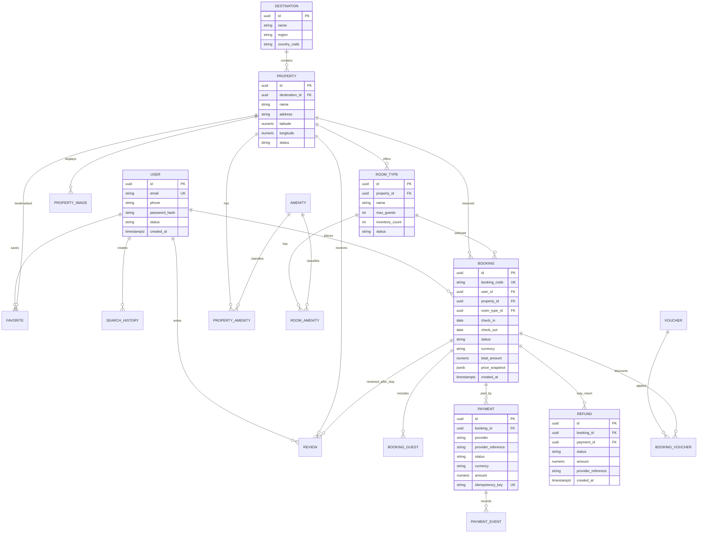

# System design proposal — StayNest

Trạng thái: đề xuất dựa **chỉ trên Page 1** trong [FIGMA_ANALYSIS.md](FIGMA_ANALYSIS.md). Page 2 và Page 3 là demo theo xác nhận của người dùng nên bị loại khỏi phạm vi màn hình/yêu cầu. Đây chưa phải đặc tả nghiệp vụ đã được duyệt. Một số nội dung giao dịch, bản đồ và liên hệ trên Page 1 được đánh dấu DEMO/mô phỏng; chỉ nên triển khai nghiệp vụ thật sau khi chủ sản phẩm chốt các câu hỏi ở cuối tài liệu.

## 1. Phạm vi chức năng thể hiện trong Figma

| Nhóm | Bằng chứng UI | Ghi chú trạng thái |
|---|---|---|
| Khởi động và xác thực | Splash/onboarding, welcome, đăng nhập/đăng ký, OTP, quên/đổi mật khẩu | UX cụ thể; provider, chính sách mật khẩu và xác minh cần chốt |
| Khám phá và tìm kiếm | Trang chủ, điểm đến, lịch sử, ngày, khách/phòng, giá, tiện nghi, sort, list/map | Map Page 1 ghi mô phỏng; data source và bộ lọc thật chưa được chỉ định |
| Chỗ ở và nội dung | Chi tiết chỗ, ảnh, phòng, tiện nghi, vị trí, chính sách, review | Nội dung mẫu có tên homestay, đánh giá và giá minh họa; chưa rõ quản trị/cấp dữ liệu |
| Cá nhân hóa | Yêu thích, so sánh, gợi ý sở thích, ưu đãi/voucher | Hành vi được biểu đạt qua màn; quy tắc giá/điều kiện ưu đãi chưa rõ |
| Đặt phòng | Thông tin khách, yêu cầu đặc biệt, giá, voucher, xác nhận | Luồng có các bước rõ; thời hạn giữ chỗ 15 phút xuất hiện nhưng chưa biết rule thật |
| Thanh toán | Ví demo, thẻ nội địa/quốc tế, xử lý, kết quả, receipt | Nhiều màn ghi demo/mô phỏng; chưa có PSP/acquirer được nêu |
| Sau đặt phòng | Chuyến đi, voucher, chỉ đường, đổi ngày, hủy, refund tracking, FAQ/chat, review sau lưu trú | Một số trạng thái được mô tả là mô phỏng; quyền host, chính sách và nguồn trạng thái cần xác nhận |
| Tài khoản | Hồ sơ, chỉnh sửa, cài đặt, thông báo, location permission | Chưa rõ đồng bộ thiết bị, phân quyền dữ liệu và tùy chọn thông báo |

## 2. Kiến trúc đề xuất

Tách Flutter app và Node/Express API. PostgreSQL là nguồn dữ liệu bền vững. Thiết kế ở mức module để tránh đưa nghiệp vụ bên ngoài chưa duyệt vào MVP.

### Flutter

- `presentation/`: router, screen theo frame, reusable widgets, responsive scaffold; tách widget chứa nội dung cuộn khỏi status/navigation chrome theo đúng cấu trúc từng frame.
- `domain/`: entities, value objects, repository interfaces và use cases.
- `data/`: REST clients, DTO serialization, repository implementations, auth token storage và cache cục bộ có phạm vi rõ.
- Riverpod cho dependency injection và state theo feature (`auth`, `search`, `property`, `favorites`, `booking`, `payment`, `trips`, `profile`). Trạng thái loading/error/empty/success phải khớp các frame tương ứng.
- go_router cho nested shell tabs (Khám phá/Tìm kiếm/Yêu thích/Chuyến đi/Tài khoản), auth routes và booking routes. Deep link tới booking/property chỉ thêm sau khi chốt format.
- `design_system/`: color/type/spacing/radius/elevation tokens được trích frame-by-frame trong Phase 3; Figma hiện không có token/style library local.
- Ảnh/icon dùng export asset gốc từ Figma; ảnh listing lấy từ backend/CDN, không bundle mock ảnh làm dữ liệu runtime.

### Backend

- Express REST API có module `auth`, `catalog`, `search`, `favorites`, `comparison`, `booking`, `payments`, `trips`, `reviews`, `support`, `profile`.
- Các module demo có thể bị tắt/đánh dấu `demo` theo environment; dữ liệu demo không được ghi thành giao dịch đã thu tiền hoặc đặt chỗ xác nhận thật.
- Validation schema ở biên API, request ID, thống nhất lỗi, logs không chứa mật khẩu/OTP/token/chi tiết thẻ. API version prefix `/api/v1`.
- Repository/service layer giao tiếp PostgreSQL; transaction cho tạo reservation, áp voucher và ghi nhận payment event; idempotency cho thao tác tạo booking/payment/refund.
- Tích hợp email/SMS/OTP, maps, payment provider, object storage, push notifications là adapters tùy chọn; chưa cấu hình nhà cung cấp nào khi chưa được xác nhận.
- Migrations có phiên bản và dữ liệu seed chỉ cho môi trường local/demo; production không dùng dữ liệu mẫu thay cho catalog hoặc thanh toán thật.

## 3. Đề xuất mô hình dữ liệu PostgreSQL

ERD logic tối thiểu. Các cột/quan hệ là đề xuất; giá, thuế, refund và chính sách có thể cần snapshot theo booking để dữ liệu lịch sử không đổi khi catalog được cập nhật.

Các bảng dự kiến bổ sung khi chốt nghiệp vụ: `user_profiles`, `auth_challenges` (OTP hash, expiry, attempt counter), `property_images`, `amenities`, join tables, `availability`/inventory holds, `search_history`, `favorites`, `vouchers`, `booking_guests`, `booking_vouchers`, `payment_events`, `reviews`, `notifications`, `support_threads/messages`, `audit_events`. Không lưu PAN/CVV của thẻ; PSP token hóa dữ liệu thẻ. Dùng `numeric` cho tiền, mã ISO currency và UTC timestamps. Chốt retention cho OTP, lịch sử tìm kiếm, chat và dữ liệu định danh.

## 4. REST API đề xuất

Đây là contract khởi đầu để thảo luận, không cam kết các nghiệp vụ chưa được duyệt. Pagination bằng cursor/page thống nhất; validate query, body và giới hạn kích thước.

| Endpoint | Mục đích |
|---|---|
| `POST /api/v1/auth/register` | Tạo tài khoản, nếu xác nhận đăng ký bằng email/điện thoại |
| `POST /api/v1/auth/login` | Đăng nhập |
| `POST /api/v1/auth/otp/request`, `POST /api/v1/auth/otp/verify` | OTP có giới hạn tần suất và thời hạn |
| `POST /api/v1/auth/password/reset` | Đặt lại mật khẩu sau challenge hợp lệ |
| `GET /api/v1/me`, `PATCH /api/v1/me` | Đọc/cập nhật hồ sơ chủ thể hiện tại |
| `GET /api/v1/destinations`, `GET /api/v1/destinations/:id` | Catalog điểm đến |
| `GET /api/v1/properties` | Search/filter/sort/cursor theo destination, ngày, khách, phòng, giá, tiện nghi, loại hình |
| `GET /api/v1/properties/:id`, `GET /api/v1/properties/:id/rooms` | Chi tiết chỗ ở/phòng/tiện ích/chính sách |
| `GET /api/v1/properties/:id/reviews` | Review phân trang và filter |
| `GET/POST/DELETE /api/v1/me/favorites/:propertyId` | Danh sách/thêm/bỏ yêu thích |
| `POST /api/v1/comparisons` | Đối chiếu tối đa ba property; có thể client-side nếu chỉ là thao tác tạm |
| `GET /api/v1/vouchers`, `POST /api/v1/vouchers/validate` | Xem và kiểm tra điều kiện voucher |
| `POST /api/v1/booking-quotes` | Tính tổng tiền phía server từ availability, giá, phí và voucher |
| `POST /api/v1/bookings` | Tạo booking/hold có idempotency và snapshot giá |
| `GET /api/v1/bookings/:id`, `GET /api/v1/me/bookings` | Chi tiết và danh sách chuyến đi |
| `POST /api/v1/bookings/:id/change-date-requests` | Gửi yêu cầu đổi ngày nếu được policy hỗ trợ |
| `POST /api/v1/bookings/:id/cancellations` | Yêu cầu hủy và tính preview refund theo policy |
| `GET /api/v1/bookings/:id/refund` | Trạng thái hoàn tiền từ provider/ledger |
| `POST /api/v1/payments/intents`, `POST /api/v1/payments/:id/confirm` | Payment intent và xác nhận theo PSP đã chọn |
| `POST /api/v1/payments/webhooks/:provider` | Webhook ký số; idempotent và chống replay |
| `POST /api/v1/bookings/:id/reviews` | Tạo review sau khi xác nhận đủ điều kiện lưu trú |
| `GET /api/v1/notifications`, `PATCH /api/v1/notifications/:id` | Danh sách/đánh dấu đã đọc |
| `GET/POST /api/v1/support/threads`, `GET/POST /api/v1/support/threads/:id/messages` | Hỗ trợ nếu chat được duyệt làm chức năng thật |

Lỗi dự kiến: `{ error: { code, message, details?, requestId } }`; không trả stack trace. 401 khi thiếu/hết hạn auth, 403 khi không thuộc booking, 409 khi inventory/voucher trạng thái xung đột, 422 khi dữ liệu hợp lệ về cú pháp nhưng vi phạm quy tắc.

## 5. Authentication / authorization

- UI có đăng nhập tài khoản và OTP. Đề xuất access token ngắn hạn + refresh rotation lưu an toàn ở Flutter, password hash bằng thuật toán chuyên dụng ở backend, OTP dạng hash có expiry, rate limit và giới hạn thử.
- Authorization tối thiểu: guest đọc catalog; user chỉ đọc/cập nhật hồ sơ, favorites, bookings, payment receipts và support thread của mình; quản trị/host chỉ cần nếu có portal/host workflow được duyệt.
- Google sign-in, xác minh email/SMS, social linking, MFA và vai trò host/admin chưa được chứng minh chỉ từ frame; cần xác nhận trước khi triển khai.
- Không chấp nhận trạng thái booking/payment từ client làm sự thật; backend xác nhận inventory/payment qua nguồn tin cậy. Các trạng thái trên UI phải phân biệt demo và production.

## 6. Ranh giới xác định và cần xác nhận

### Có thể coi là yêu cầu UI đã thể hiện

- Các nhóm màn hình và form/nhãn nêu trong `FIGMA_ANALYSIS.md`.
- Có trạng thái load/empty/error/success; lọc/sắp xếp, danh sách/bản đồ mock; favorites/compare; booking nhiều bước; các màn chuyến đi, đổi/hủy/refund và support.
- Layout thiết kế mobile rộng 390 px; app Flutter, Riverpod, go_router, Express, PostgreSQL, REST, env config theo yêu cầu người dùng.

### Không thể suy ra an toàn và cần chủ sản phẩm quyết định

1. Backend có cần booking, thanh toán, hủy/refund, chat và review giao dịch thật ở MVP hay chỉ hoàn thiện UI prototype? Các frame có chú thích demo/mô phỏng.
2. Nguồn inventory/property/room/giá/thuế/phí/availability là hệ thống nào? Cần quy tắc đồng bộ tồn phòng và thời hạn giữ chỗ (15 phút đang xuất hiện trong một màn).
3. Thanh toán dùng đơn vị/cổng nào (VNPay/MoMo/Stripe/khác), phương thức nào được phát hành, xác nhận giao dịch bằng webhook ra sao và refund ai phê duyệt?
4. Quy tắc cancellation/refund: deadline, phí, partial refund, tiền tệ, SLA và trạng thái nào là authoritative?
5. Đăng nhập bằng email/điện thoại hay cả hai; OTP qua SMS/email; Google login có thật không; chính sách mật khẩu, lockout, refresh-token/session và xóa tài khoản?
6. Ai là user/host/admin? Có đăng ký/đăng nhập host, quản trị property, kiểm duyệt ảnh/review và phân quyền back-office ngoài phạm vi frame không?
7. Map/directions cần provider nào và vị trí thiết bị có opt-in, retention, xử lý khi bị từ chối ra sao?
8. Voucher/loyalty tier (Silver/Gold), giới hạn áp mã, ưu đãi và so sánh giá có quy tắc sản phẩm nào?
9. Support chat có người thật/giờ trực/SLA hay chỉ FAQ/form ticket? Nội dung hiện tại có ghi mô phỏng.
10. Thông báo là push, email, SMS hay in-app; ngôn ngữ và tiền tệ nào; Việt Nam-only hay đa quốc gia?
11. Page 1 là nguồn thiết kế duy nhất cho implementation; Page 2 và Page 3 là demo và được bỏ qua.
12. Yêu cầu vận hành: cloud/deploy target, secrets manager, backup/restore, retention, logging/monitoring, privacy/consent và môi trường dev/staging/production.

## 7. Thứ tự triển khai sau khi duyệt

1. Chốt screen source, asset export và design tokens theo Figma; duyệt danh sách route.
2. Chốt MVP backend/demo boundary, payment/inventory/auth providers và policy.
3. Chốt schema/contract rồi tạo migrations và API; tách seed/demo khỏi dữ liệu production.
4. Triển khai Flutter theo frame; kết nối API thật cho phần đã duyệt, không gắn mock vào chức năng đã backend hóa.
5. Theo Phase 5, render từng frame ở viewport tương ứng và lưu đối chiếu; chỉ báo fidelity theo bằng chứng screenshot.
